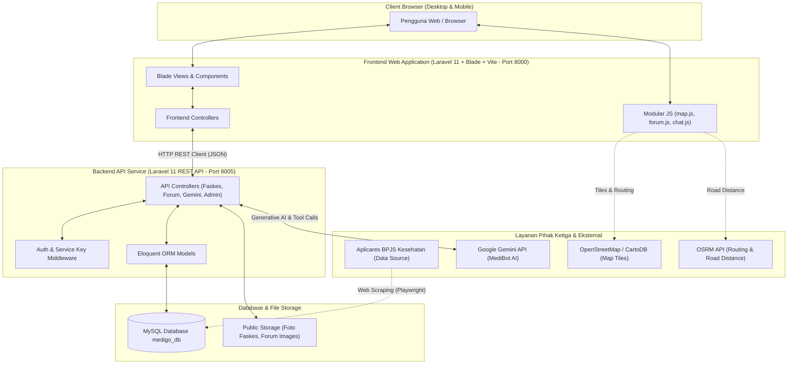
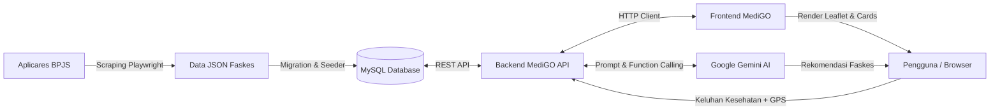

# MediGO - Platform Direktori & Komunitas Fasilitas Kesehatan Jabodetabek

[](https://laravel.com/)
[](https://www.php.net/)
[](https://getbootstrap.com/)
[](https://leafletjs.com/)
[](https://ai.google.dev/)
[](https://www.mysql.com/)
[](LICENSE)

**MediGO** adalah platform direktori interaktif dan forum komunitas fasilitas kesehatan (faskes) di wilayah **Jabodetabek**. Seluruh data direktori faskes dikumpulkan dan dikurasi melalui **web scraping data resmi Aplicares BPJS Kesehatan**, mencakup rumah sakit, puskesmas, klinik pratama & utama, apotek, laboratorium medis, optik, hingga praktik dokter umum dan dokter gigi terdekat beserta informasi rujukan BPJS, spesialisasi dokter, fasilitas penunjang, ulasan pengguna, dan konsultasi interaktif dengan asisten kecerdasan buatan (**MediBot**).

---

## 👨‍💻 Nama Tim & Daftar Anggota

**Nama Tim**: **Tim MediGO**

| No | Nama Anggota | Peran / Tanggung Jawab |
| :---: | :--- | :--- |
| 1 | **Muhammad Prima Yudhistira** | Project Manager, Front-End Developer |
| 2 | **Raden Mas Galih Pradityo** | Back-End Developer |
| 3 | **Misael Feodora Pranata Dauhan** | UI/UX Designer & Developer |
| 4 | **Osanna Patricia Limbong** | Data Analyst, Quality Assurance |

---

## 📑 Daftar Isi
1. [Identitas Proyek & Latar Belakang](#-identitas-proyek--latar-belakang)
2. [Fitur Utama](#-fitur-utama)
3. [Teknologi yang Digunakan](#-teknologi-yang-digunakan)
4. [Diagram Arsitektur Sistem & Alur Data](#-diagram-arsitektur-sistem--alur-data)
5. [Sumber & Pengumpulan Data (Scraping Aplicares BPJS)](#-sumber--pengumpulan-data-scraping-aplicares-bpjs)
6. [Dokumentasi Penggunaan AI (MediBot)](#-dokumentasi-penggunaan-ai-medibot)
7. [Panduan Instalasi & Setup Lengkap](#-panduan-instalasi--setup-lengkap)
8. [Daftar Variabel Lingkungan (.env.example)](#-daftar-variabel-lingkungan-envexample)
9. [Akun Demonstrasi (Demo & Testing)](#-akun-demonstrasi-demo--testing)
10. [Struktur Endpoint & Port Default](#-struktur-endpoint--port-default)
11. [Atribusi Aset, Dataset, & Kode Pihak Ketiga](#-atribusi-aset-dataset--kode-pihak-ketiga)
12. [Troubleshooting](#-troubleshooting)
13. [Lisensi](#-lisensi)

---

## 🎯 Identitas Proyek & Latar Belakang

- **Kategori Proyek**: **Web Application** (Responsive Web Design — dioptimalkan untuk Desktop & Mobile Browser).
- **Nama Aplikasi**: **MediGO** (*Your Health, Faster*).

### Masalah yang Diangkat
1. **Fragmentasi Informasi Faskes**: Informasi fasilitas kesehatan di Jabodetabek (rumah sakit, puskesmas, klinik, apotek, laboratorium) kerap tersebar di berbagai platform tanpa standardisasi data kontak, jam layanan, dan ketersediaan fasilitas.
2. **Kebutuhan Informasi Rujukan BPJS**: Banyak masyarakat kesulitan memastikan apakah suatu fasilitas kesehatan menerima layanan BPJS Kesehatan serta jenis fasilitas penunjang atau dokter spesialis apa saja yang tersedia di faskes tujuan.
3. **Keterbatasan Ruang Diskusi Pasien**: Minimnya forum komunitas kesehatan terpercaya dan terstruktur untuk saling bertukar pengalaman faskes, prosedur pendaftaran BPJS, serta ulasan mutu pelayanan.
4. **Kebingungan Triase Gejala Awal**: Saat mengalami keluhan kesehatan non-darurat, masyarakat sering bimbang menentukan pertolongan pertama dan jenis faskes mana yang paling tepat untuk didatangi terlebih dahulu.

### Deskripsi Solusi
MediGO hadir sebagai platform *one-stop healthcare directory & community* yang mengintegrasikan:
- Direktori ribuan faskes se-Jabodetabek yang diambil langsung dari basis data resmi **Aplicares BPJS Kesehatan**.
- Pemetaan visual interaktif geospasial berbasis **Leaflet & OpenStreetMap** dengan perhitungan jarak rute riil (OSRM) dan filter radius lokasi terdekat.
- Forum komunitas dengan sistem **mention faskes** tertaut, ulasan terverifikasi, dan pelaporan moderasi konten.
- **MediBot**, asisten AI cerdas berbasis **Google Gemini** dengan kemampuan *Function Calling* otomatis untuk mencari faskes terdekat sesuai titik koordinat GPS pengguna.

### Target Pengguna
1. **Masyarakat Umum & Pasien**: Pasien umum maupun peserta BPJS Kesehatan di wilayah Jabodetabek yang memerlukan rujukan dan pencarian faskes terdekat.
2. **Keluarga Pasien**: Pengguna yang membutuhkan panduan rute navigasi, kontak telepon darurat, dan ketersediaan fasilitas penunjang medis secara instan.
3. **Pengguna yang Membutuhkan Triase Awal**: Individu yang ingin berkonsultasi mengenai gejala penyakit ringan dan rekomendasi jenis faskes melalui asisten AI.
4. **Administrator & Pengelola Faskes**: Tim pengelola data master faskes, dokter spesialis, fasilitas penunjang, serta tim moderasi laporan forum.

---

## 🌟 Fitur Utama

Berikut adalah daftar fitur utama yang **berhasil diimplementasikan 100%**:

1. **Direktori & Pencarian Multi-Filter Faskes**:
   - Filter cepat berdasarkan kategori: Rumah Sakit, Puskesmas, Klinik, Apotek, Laboratorium, Optik, Dokter Gigi, Dokter Umum, dan Faskes Mitra BPJS.
   - Filter wilayah (Provinsi DKI Jakarta, Jawa Barat, Banten dan seluruh Kabupaten/Kota di Jabodetabek).
   - Filter lanjutan berdasarkan ketersediaan spesialisasi dokter dan fasilitas penunjang medis.
2. **Peta Interaktif & Live Geolocation (Leaflet View)**:
   - Deteksi koordinat GPS pengguna (*browser geolocation*).
   - Pin marker kustom sesuai jenis faskes dengan indikator status BPJS.
   - Filter radius jarak dinamis (slider 1.0 km - 25.0 km).
   - Sinkronisasi jarak rute jalan riil melalui Open Source Routing Machine (OSRM).
   - Tombol navigasi langsung menuju Google Maps rute faskes.
3. **Halaman Detail Faskes Komprehensif**:
   - Informasi alamat bersih, nomor telepon/kontak, kelas faskes, dan status BPJS.
   - Galeri foto faskes interaktif dengan pratinjau modal *full-screen* (*prev/next navigation*).
   - Daftar fasilitas penunjang medis dan spesialisasi dokter yang berpraktek.
   - Tab ulasan pengguna dan formulir penulisan rating/ulasan.
4. **Sistem Rating & Ulasan Pengguna**:
   - Pemberian rating bintang 1 hingga 5 dan ulasan pengalaman faskes.
   - Perhitungan otomatis nilai rata-rata rating dan total ulasan.
   - Hak kelola (ubah dan hapus) ulasan milik pengguna yang sedang login.
5. **Forum Komunitas Kesehatan Interaktif**:
   - Kategori topik terstruktur: *Tanya BPJS*, *Umum*, *Rekomendasi RS*, dan *Tips Kesehatan*.
   - Fitur **Mention Faskes**: Input pencarian live (*autocomplete*) untuk menautkan satu fasilitas kesehatan langsung ke dalam topik diskusi.
   - Unggah lampiran foto (maksimal 3 foto per diskusi, otomatis validasi tipe & ukuran).
   - Filter diskusi *Semua*, *Faskes Terdekat* (berdasarkan GPS user), dan *Sedang Tren* (berdasarkan jumlah suka/like).
   - Interaksi komentar berantai (*thread discussion*) dan tombol suka (*like/unlike*).
6. **Sistem Moderasi & Pelaporan Konten**:
   - Pelaporan topik diskusi atau komentar faskes yang melanggar ketentuan komunitas.
   - Formulir alasan pelaporan (*spam*, ujaran kebencian, informasi palsu, dll).
7. **MediBot — Asisten AI Kesehatan Cerdas**:
   - Konsultasi gejala awal berbasis Google Gemini Generative AI.
   - Kemampuan *Function Calling*: AI otomatis memanggil fungsi `cari_faskes` dengan koordinat GPS user untuk merekomendasikan faskes terdekat yang relevan.
   - Rekam jejak percakapan (*chat session history*) tersimpan di database.
8. **Panel Dashboard & Manajemen Admin**:
   - Ringkasan statistik faskes, pengguna, ulasan, dan metrik pertumbuhan bulanan.
   - Manajemen Faskes (CRUD, unggah foto galeri otomatis WebP, koordinat peta).
   - Manajemen Master Spesialisasi Dokter (CRUD).
   - Manajemen Master Fasilitas Penunjang Medis (CRUD).
   - Moderasi Masukan Data Faskes & Laporan Komentar Pengguna (*takedown* / *dismiss*).
9. **Autentikasi & Profil Pengguna**:
   - Registrasi dan login berbasis sesi web aman.
   - Halaman profil pengguna, perubahan kata sandi, dan tab riwayat ulasan yang pernah ditulis.

---

## 🛠 Teknologi yang Digunakan

| Kategori | Teknologi / Library | Versi | Kegunaan |
| :--- | :--- | :--- | :--- |
| **Backend Framework** | [Laravel](https://laravel.com/) | 11.x | RESTful API Service, Autentikasi, Eloquent ORM, Database Migration & Seeding |
| **Frontend Framework** | [Laravel Blade](https://laravel.com/) + [Vite](https://vitejs.dev/) | 11.x / 6.x | Antarmuka pengguna (Server-Side Rendering), aset *bundling* modular |
| **Bahasa Pemrograman** | [PHP](https://www.php.net/) | 8.2+ | Bahasa utama backend dan controller frontend |
| **UI Library & CSS** | [Bootstrap](https://getbootstrap.com/) | 5.3.3 | Kerangka tata letak responsif, komponen kartu, dan modal |
| **Icon Pack** | [Bootstrap Icons](https://icons.getbootstrap.com/) | 1.11.x | Ikonografi seluruh halaman web |
| **Database Server** | [MySQL](https://www.mysql.com/) / MariaDB | 8.0+ / 10.4+ | Penyimpanan relasional faskes, ulasan, forum, user, dan chat AI |
| **Peta Digital** | [Leaflet.js](https://leafletjs.com/) | 1.9.4 | *Interactive map engine*, pin marker kustom, dan radius visualizer |
| **Tile Provider** | [OpenStreetMap](https://www.openstreetmap.org/) & CartoDB | Positron / OSM | Peta dasar *clean light* untuk tampilan Leaflet |
| **Routing Engine** | [OSRM API](http://project-osrm.org/) | v1 | Perhitungan jarak dan durasi tempuh rute jalan darat |
| **Kecerdasan Buatan (AI)** | [Google Gemini API](https://ai.google.dev/) | 1.5 Flash / Pro | Model AI percakapan kesehatan MediBot + *Function Calling* |
| **Web Scraping** | [Python Playwright](https://playwright.dev/python/) | 3.11+ / 1.40+ | Otomasi browser Chromium untuk ekstraksi data Aplicares BPJS |

---

## 📐 Diagram Arsitektur Sistem & Alur Data

### 1. Diagram Arsitektur Sistem (Decoupled Architecture)



### 2. Diagram Alur Data (Data Flow)



---

## 📊 Sumber & Pengumpulan Data (Scraping Aplicares BPJS)

Data fasilitas kesehatan yang digunakan di MediGO bersumber langsung dari sistem rujukan fasilitas kesehatan nasional resmi:

- **Sumber Primer**: Portal resmi **[Aplicares BPJS Kesehatan](https://faskes.bpjs-kesehatan.go.id/aplicares/)** (Aplikasi Ketersediaan Tempat Tidur & Fasilitas Kesehatan BPJS Kesehatan Republik Indonesia).
- **Metode Scraping**: Menggunakan modul otomasi browser Python & Playwright (`medigo/scraper/scraper_bpjs.py`) yang mengotomasi penjelajahan portal per provinsi (DKI Jakarta, Jawa Barat, dan Banten), mengurai respons terenkripsi JWE/JSON Aplicares, dan mengekstrak entitas data:
  - Kode Faskes resmi (KDPPK) & Nama Fasilitas Kesehatan
  - Jenis Fasilitas (Rumah Sakit, Puskesmas, Klinik Pratama/Utama, Apotek, Laboratorium, Optik, Praktik Mandiri Dokter Gigi/Umum)
  - Alamat lengkap, kode pos, kecamatan, dan kota/kabupaten
  - Nomor telepon / kontak darurat
  - Status kerjasama aktif BPJS Kesehatan
- **Cakupan Wilayah**: Menjangkau lebih dari **3.000 fasilitas kesehatan** di seluruh wilayah **Jabodetabek** (DKI Jakarta, Kota/Kab. Bogor, Kota Depok, Kota/Kab. Tangerang, Kota Tangerang Selatan, serta Kota/Kab. Bekasi).
- **Pengayaan Koordinat Geospasial**: Hasil scraping kemudian diintegrasikan dengan koordinat lintang (*latitude*) dan bujur (*longitude*) untuk mengaktifkan pemetaan pin marker Leaflet, filter radius jarak, dan rute navigasi Google Maps.

---

## 🤖 Dokumentasi Penggunaan AI (MediBot)

MediGO mengintegrasikan asisten kecerdasan buatan bernama **MediBot** untuk membantu pengguna dalam berkonsultasi seputar kesehatan dan pemilihan faskes:

1. **Model yang Digunakan**: **Google Gemini API** (`gemini-1.5-flash` sebagai model utama berkecepatan tinggi, atau `gemini-1.5-pro`).
2. **Tujuan & Use Case**:
   - Sebagai asisten triase awal informasi kesehatan non-darurat.
   - Membantu pengguna memahami gejala umum dan memberikan saran pertolongan pertama yang aman.
   - Memberikan rekomendasi jenis fasilitas kesehatan (misal: Puskesmas untuk keluhan ringan, IGD Rumah Sakit untuk darurat, atau Klinik Spesialis).
3. **Implementasi Teknis & Function Calling**:
   - Diimplementasikan pada backend controller `GeminiController.php` dan `GeminiClient.php`.
   - Menggunakan teknik **Tool / Function Calling** (`cari_faskes`): saat pengguna menanyakan faskes terdekat, model secara otomatis mengekstrak koordinat GPS pengguna dan parameter pencarian, memanggil fungsi backend, dan menampilkan kartu faskes yang relevan langsung di ruang obrolan.
   - Sistem percakapan *multi-turn* dengan riwayat obrolan (*context history*) yang tersimpan rapi di tabel `gemini_chats`.
   - Penerapan *Rate Limiting* untuk mencegah eksploitasi API bagi pengguna *guest* maupun akun terdaftar.
4. **Batasan Etis & Disclaimer Medis**:
   > [!IMPORTANT]
   > MediBot bukan pengganti diagnosis dokter atau tenaga medis profesional. Setiap rekomendasi yang diberikan selalu disertai *medical disclaimer* agar pengguna segera menuju fasilitas kesehatan terdekat jika mengalami gejala darurat.

---

## 🚀 Panduan Instalasi & Setup Lengkap

### Prasyarat Sistem (Prerequisites)
- **PHP** >= 8.2 (ekstensi: `pdo_mysql`, `mbstring`, `openssl`, `curl`, `fileinfo`, `gd`, `bcmath`)
- **Composer** >= 2.x
- **Node.js** >= 18.x & **NPM** >= 9.x
- **Database Server**: MySQL >= 8.0 atau MariaDB >= 10.4 (Laragon / XAMPP direkomendasikan)
- **Git**

---

### 1. Setup Backend (`medigo/backend`)

Buka terminal pada direktori `medigo/backend`:

```bash
# 1. Masuk ke folder backend
cd medigo/backend

# 2. Pasang dependensi PHP
composer install

# 3. Salin file environment
cp .env.example .env
```

Buka file `.env` di `medigo/backend` dan sesuaikan koneksi database MySQL serta Gemini API:
```env
APP_NAME=MediGO_Backend
APP_ENV=local
APP_KEY=
APP_DEBUG=true
APP_URL=http://127.0.0.1:8005

DB_CONNECTION=mysql
DB_HOST=127.0.0.1
DB_PORT=3306
DB_DATABASE=medigo_db
DB_USERNAME=root
DB_PASSWORD=

# Kunci API Google Gemini untuk MediBot
GEMINI_API_KEY=your_gemini_api_key_here
GEMINI_MODEL=gemini-1.5-flash
GEMINI_TIMEOUT=30

# Kunci otorisasi internal antara Frontend dan Backend
MEDIGO_SERVICE_KEY=medigo_shared_secret_key_2026
```

Lanjutkan perintah terminal:
```bash
# 4. Generate application encryption key
php artisan key:generate

# 5. Jalankan migrasi tabel dan seeding data master faskes & akun demo
php artisan migrate --seed

# 6. Hubungkan folder storage publik
php artisan storage:link

# 7. Jalankan server Backend di port 8005
php artisan serve --port=8005
```
Backend API kini berjalan pada: `http://127.0.0.1:8005`

---

### 2. Setup Frontend (`medigo/frontend`)

Buka terminal **baru** pada direktori `medigo/frontend`:

```bash
# 1. Masuk ke folder frontend
cd medigo/frontend

# 2. Pasang dependensi PHP & Node.js
composer install
npm install

# 3. Salin file environment
cp .env.example .env
```

Buka file `.env` di `medigo/frontend` dan sesuaikan konfigurasi berikut:
```env
APP_NAME=MediGO
APP_ENV=local
APP_KEY=
APP_DEBUG=true
APP_URL=http://127.0.0.1:8000

# Arahkan ke port API Backend MediGO
MEDIGO_BE=http://127.0.0.1:8005
MEDIGO_SERVICE_KEY=medigo_shared_secret_key_2026

SESSION_DRIVER=file
```

Lanjutkan perintah terminal:
```bash
# 4. Generate application key frontend
php artisan key:generate

# 5. Hubungkan folder storage publik
php artisan storage:link

# 6. Kompilasi aset CSS & JS Vite
npm run build

# 7. Jalankan server Frontend di port 8000
php artisan serve --port=8000
```

> [!TIP]
> Untuk mode pengembangan aktif (*live reload*), Anda dapat menjalankan `npm run dev` di terminal frontend.

Aplikasi MediGO kini siap diakses melalui peramban: **`http://127.0.0.1:8000`**

---

## 📋 Daftar Variabel Lingkungan (.env.example)

### Backend (`medigo/backend/.env.example`)
| Variabel | Deskripsi | Default / Rekomendasi |
| :--- | :--- | :--- |
| `APP_NAME` | Nama aplikasi backend | `MediGO_Backend` |
| `APP_ENV` | Mode lingkungan sistem | `local` |
| `APP_URL` | URL basis host backend | `http://127.0.0.1:8005` |
| `DB_CONNECTION` | Driver koneksi database | `mysql` |
| `DB_HOST` | Alamat IP server database | `127.0.0.1` |
| `DB_PORT` | Port layanan MySQL | `3306` |
| `DB_DATABASE` | Nama basis data MediGO | `medigo_db` |
| `DB_USERNAME` | Pengguna database | `root` |
| `DB_PASSWORD` | Kata sandi database | *(kosong jika lokal)* |
| `GEMINI_API_KEY` | Kunci API Google Gemini | *(Dapatkan dari Google AI Studio)* |
| `GEMINI_MODEL` | Varian model Gemini untuk AI | `gemini-1.5-flash` |
| `GEMINI_TIMEOUT` | Batas waktu respon AI (detik) | `30` |
| `MEDIGO_SERVICE_KEY` | Kunci otorisasi antarservice | *String rahasia shared key* |

### Frontend (`medigo/frontend/.env.example`)
| Variabel | Deskripsi | Default / Rekomendasi |
| :--- | :--- | :--- |
| `APP_NAME` | Nama aplikasi frontend | `MediGO` |
| `APP_ENV` | Mode lingkungan sistem | `local` |
| `APP_URL` | URL basis host frontend | `http://127.0.0.1:8000` |
| `MEDIGO_BE` | URL target backend API | `http://127.0.0.1:8005` |
| `MEDIGO_SERVICE_KEY` | Kunci sinkronisasi service backend | *Sama dengan MEDIGO_SERVICE_KEY Backend* |
| `SESSION_DRIVER` | Penyimpanan sesi web login | `file` |

---

## 👥 Akun Demonstrasi (Demo & Testing)

Gunakan akun berikut untuk menguji seluruh fungsionalitas sistem:

| Role Akun | Email Pengguna | Kata Sandi | Hak Akses & Fitur yang Dapat Diuji |
| :--- | :--- | :--- | :--- |
| **Administrator** | `admin@medigo.id` | `password` | • Akses Panel Admin (`/admin/dashboard`)<br>• CRUD Fasilitas Kesehatan & Galeri Foto<br>• CRUD Master Spesialisasi Dokter<br>• CRUD Master Fasilitas Penunjang Medis<br>• Moderasi Laporan Masukan Faskes & Komentar |
| **Pengguna Umum** | `dimas.pratama@gmail.com` | `password` | • Eksplorasi direktori & peta faskes<br>• Menulis rating bintang & ulasan faskes<br>• Membuat topik diskusi forum & unggah foto<br>• Mengomentari dan menyukai diskusi<br>• Konsultasi interaktif dengan AI MediBot |

---

## 🌐 Struktur Endpoint & Port Default

| Komponen Sistem | URL Akses | Deskripsi & Fungsi |
| :--- | :--- | :--- |
| **Frontend Web** | `http://127.0.0.1:8000` | Beranda portal web MediGO |
| **Peta Faskes (Map View)** | `http://127.0.0.1:8000/map` | Peta interaktif Leaflet faskes se-Jabodetabek |
| **Forum Komunitas** | `http://127.0.0.1:8000/discussions` | Forum komunitas diskusi faskes & tanya BPJS |
| **MediBot AI Chat** | `http://127.0.0.1:8000/chat` | Ruang konsultasi kesehatan kecerdasan buatan |
| **Dashboard Admin** | `http://127.0.0.1:8000/admin/dashboard` | Area panel kontrol administrasi dan moderasi |
| **Backend REST API** | `http://127.0.0.1:8005/api` | API penyedia data faskes, ulasan, forum, & AI |

---

## 📜 Atribusi Aset, Dataset, & Kode Pihak Ketiga

Pengembangan proyek MediGO memanfaatkan beberapa aset, dataset, dan pustaka pihak ketiga dengan atribusi sebagai berikut:

1. **Dataset Fasilitas Kesehatan**:
   - Bersumber dari **Aplicares BPJS Kesehatan** ([faskes.bpjs-kesehatan.go.id/aplicares](https://faskes.bpjs-kesehatan.go.id/aplicares/)), hak cipta data milik Badan Penyelenggara Jaminan Sosial Kesehatan Republik Indonesia.
2. **Peta & Geospasial**:
   - Peta digital © [OpenStreetMap](https://www.openstreetmap.org/copyright) contributors.
   - Peta *tile layer* CartoDB Positron oleh [CARTO](https://carto.com/attributions).
   - Mesin rute jalan darat oleh [Project OSRM](http://project-osrm.org/).
   - Pustaka peta interaktif oleh [LeafletJS](https://leafletjs.com/).
3. **Kecerdasan Buatan (AI)**:
   - Google Generative AI / [Google Gemini API](https://ai.google.dev/) oleh Google LLC.
4. **Desain & UI Components**:
   - Kerangka UI oleh [Bootstrap 5](https://getbootstrap.com/) (Lisensi MIT).
   - Ikon grafis oleh [Bootstrap Icons](https://icons.getbootstrap.com/) (Lisensi MIT).
   - Tipografi *Inter Font Family* oleh Rasmus Andersson via [Google Fonts](https://fonts.google.com/specimen/Inter) (SIL Open Font License).
5. **Framework & Alat Otomasi**:
   - Framework [Laravel](https://laravel.com/) (Lisensi MIT).
   - Otomasi web [Playwright Python](https://playwright.dev/) oleh Microsoft (Lisensi Apache 2.0).
   - Bundler aset [Vite](https://vitejs.dev/) oleh Evan You & Tim Vite (Lisensi MIT).

---

## 🔧 Troubleshooting

1. **Gambar atau Ikon Logo Tidak Muncul**:
   Pastikan symlink storage telah dibuat di kedua aplikasi:
   ```bash
   cd medigo/backend && php artisan storage:link
   cd ../frontend && php artisan storage:link
   ```
2. **Error `cURL error 7: Failed to connect to 127.0.0.1 port 8005`**:
   Pastikan server backend sudah aktif berjalan pada port 8005 menggunakan `php artisan serve --port=8005`.
3. **Peta Leaflet Tidak Menampilkan Pin Marker**:
   Pastikan browser Anda terhubung ke internet untuk memuat tile peta OpenStreetMap dan izin lokasi (*geolocation*) telah diaktifkan pada peramban.
4. **MediBot Tidak Memberikan Respon**:
   Pastikan variabel `GEMINI_API_KEY` pada file `medigo/backend/.env` telah terisi dengan kunci API yang valid dari Google AI Studio.
5. **Membersihkan Cache Laravel Secara Keseluruhan**:
   ```bash
   php artisan route:clear
   php artisan view:clear
   php artisan config:clear
   php artisan cache:clear
   ```

---

## 📄 Lisensi

Hak Cipta © 2026 **Tim MediGO**. Seluruh kode sumber dirilis di bawah lisensi [MIT License](LICENSE).
